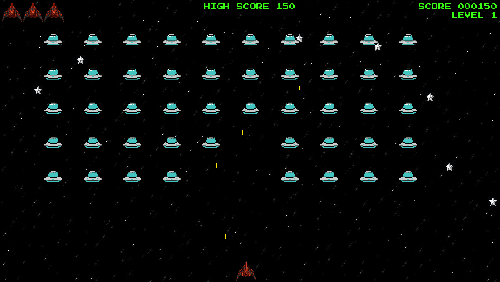

# Alien Invaders

A 2D retro arcade shoot 'em up built with Python and Pygame. Defend against descending alien formations across escalating difficulty tiers, track live telemetry on the scoreboard, and compete for the high score against a procedurally generated starfield.



---

## Features

- **Tiered Difficulty & Wave Scaling:** Choose your starting intensity and battle alien fleets that accelerate with every cleared wave.
- **Procedural Starfield:** Custom dual-layer star background featuring randomized scale distributions, positional jitter, and sparse metallic flare stars.
- **High-Contrast Arcade Visuals:** Pitch-black space canvas paired with cyan UFO fleets, neon yellow laser projectiles, and classic neon green HUD elements.
- **Audio Engine:** Full soundtrack playback ("CORE") alongside responsive sound effects for laser fire and ship explosions.
- **Ready-to-Play Windows Build:** Packaged as a standalone executable—no Python installation or setup required to play.

---

## Controls

| Key | Action |
| :--- | :--- |
| `A` / `D` | Move Ship Left / Right |
| `Spacebar` | Fire Lasers |
| `P` | Start Game |
| `Q` | Quit Game |

---

## How to Play (Windows)

The game is pre-packaged into a standalone executable. You do not need Python installed to play.

1. Go to the **[Releases](../../releases)** section on the right sidebar.
2. Download **`Alien_Invaders-v1.0.0-Windows.zip`** from the latest release.
3. Extract the `.zip` archive anywhere on your PC.
4. Open the extracted `Alien_Invaders` folder and double-click **`Alien_Invaders.exe`** to launch the game.

---

## Running from Source (For Developers)

If you want to view or modify the Python source code directly:

1. **Clone the repository:**
   ```bash
   git clone https://github.com/Tanmay-777/Alien_Invaders.git
   cd Alien_Invaders
   ```

2. **Install Pygame:**
   ```bash
   pip install pygame
   ```

3. **Run the main script:**
   ```bash
   python alien_invasion.py
   ```

---

## Project Structure

```text
Alien_Invaders/
├── fonts/               # Arcade typography assets
├── images/              # Sprites (ship, UFO fleet, star variants)
├── sounds/              # Soundtrack (OST.mp3) and SFX (.wav)
├── alien.py             # Alien fleet behavior and boundary logic
├── alien_invasion.py    # Core game loop, state management, and rendering
├── bullet.py            # Laser projectile handling and screen culling
├── button.py            # UI menu rendering
├── game_stats.py        # Session state, lives, and high-score tracking
├── scoreboard.py        # Neon green HUD and developer/music watermarks
├── settings.py          # Game constants, scaling speeds, and dimensions
├── ship.py              # Player movement and collision bounds
└── stars.py             # Procedural starfield generation
```

---

## Credits

- **Developer:** [Tanmay-777](https://github.com/Tanmay-777)
- **Soundtrack:** *"CORE"* by Toby Fox (*UNDERTALE* OST)
